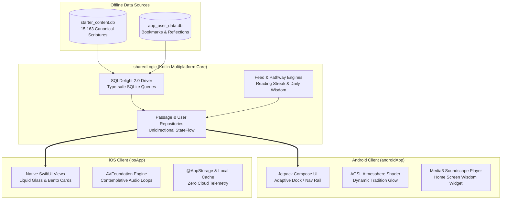

# Fathom

Fathom is an offline-first sacred wisdom and philosophical text reader. It gathers over 15,000 verses across 7 ancient traditions—Sanatana Dharma (Hinduism), Buddhism, Taoism, Stoicism, Christianity, Islam, and Judaism—into a calm, distraction-free reading sanctuary.

There are no social feeds, metrics, algorithms, ads, or tracking. The app lives completely on your device.

---

## The Vision & Experience

- **A Contemplative Instrument:** Designed like a sacred physical book rather than a social app. Typographically set in Fraunces, Newsreader, Geist, and Geist Mono.
- **100% Offline & Private:** 15,163 verses, translations, commentary, bookmarks, and reflection notes are stored in local SQLite databases right on your device. Zero telemetry leaves your phone.
- **Dynamic Atmosphere:** Each tradition has its own tone and emblem that subtly tints the atmosphere shader, ambient backdrops, and reading chrome.
- **Sacred Soundscapes:** Built-in looping audio environments (Temple Rain, Distant Storm, Sanctuary Night, Sacred River, Singing Bowl, Brown Noise) encoded in lightweight Opus audio for deep contemplation.

---

## Current Platform Status

> **Important Note on iOS:**
> Fathom is engineered from the ground up as a Kotlin Multiplatform (KMP) project with a complete native SwiftUI interface (`iosApp/`). However, because I do not currently own a Mac or an iPhone, the iOS target cannot be actively compiled or released to the Apple App Store right now.
>
> All shared logic, database schemas, and the full native SwiftUI codebase (Feed, Pathways, Search, Journal, Onboarding, Ambience Audio, and Sanctuary Hub) are written and structured cleanly so that whenever macOS hardware becomes available, the iOS app can be built and shipped directly with minimal friction.
>
> **Android is the primary production target right now**, currently undergoing closed testing for Google Play.

---

## Architectural Overview

Fathom follows an offline-first **Kotlin Multiplatform (KMP)** architecture:



### Module Breakdown

```
├── sharedLogic/                 # Pure Kotlin Multiplatform core
│   ├── commonMain/              # Domain models, SQLDelight schemas, repositories, feed engine
│   ├── androidMain/             # Android drivers & AndroidSqliteDriver configuration
│   └── iosMain/                 # iOS NativeSqliteDriver & IosAppGraph orchestration
│
├── androidApp/                  # Native Android application
│   ├── src/main/kotlin/.../ui/  # Jetpack Compose UI (Feed, Pathways, Sanctuary, Onboarding)
│   ├── src/main/assets/         # starter_content.db and ambience Opus soundscapes
│   └── src/main/res/font/       # Variable typography (Fraunces, Newsreader, Geist)
│
├── iosApp/                      # Native iOS companion application
│   ├── iosApp/Feed/             # SwiftUI feed & verse vertical paging
│   ├── iosApp/Pathways/         # Guided cross-tradition chapter reader & DepthDial
│   ├── iosApp/Audio/            # AVFoundation ambience audio engine
│   ├── iosApp/Onboarding/       # First-launch contemplative ritual with @AppStorage
│   └── iosApp/Sanctuary/        # Streak dashboard & offline reflection hub
│
└── scripts/                     # Tooling
    └── build_content_db.py      # Data pipeline: ingests public-domain scriptures into SQLite
```

---

## Tech Stack

| Layer | Android | iOS | Shared Core |
| :--- | :--- | :--- | :--- |
| **Language** | Kotlin 2.4 | Swift 6.0 | Kotlin Multiplatform (Kotlin 2.4) |
| **UI Framework** | Jetpack Compose (Bespoke Design) | SwiftUI | — |
| **Graphics & Blur** | AGSL Runtime Shaders, Backdrop | Ultra-thin material blur | — |
| **Audio Engine** | Android Media3 / AudioTrack | AVFoundation (`AVAudioPlayer`) | — |
| **Database** | AndroidSqliteDriver (Memory-mapped) | NativeSqliteDriver | SQLDelight 2.0 |
| **State & Flow** | StateFlow, Coroutines | `@StateObject`, `@Published` | Kotlinx Coroutines |
| **Local Storage** | SharedPreferences / DataStore | `@AppStorage` (UserDefaults) | SQLite (`app_user_data.db`) |

---

## Design System

- **Tradition Tone System:** Every tradition (Hinduism, Buddhism, Stoicism, Taoism, Christianity, Islam, Judaism) owns a primary color hue that informs the AGSL atmosphere, typography accents, and morphing emblem badges.
- **Liquid Glass & Backdrops:** Translucent, frosted glass cards that sample behind the view hierarchy rather than inside it, creating a deep sense of calm layered depth.
- **Adaptive Shell:** On Android, the app dynamically morphs between a docked floating pill (phones in portrait) and an adaptive navigation rail (tablets, foldables, and landscape mode).
- **Typography Matrix:**
  - *Fraunces:* Display, sacred headlines, and titles.
  - *Newsreader:* Scriptures and editorial commentaries.
  - *Geist:* Clean user interface text and buttons.
  - *Geist Mono:* Canonical verse references and chapter indices.

---

## Building the Project

### Prerequisites
- **JDK:** Version 17 or higher
- **Android SDK:** API Level 37 (compileSdk 37, targetSdk 37, minSdk 26)

### Key Gradle Commands

```bash
# Compile and verify Android release code
./gradlew compileReleaseKotlin

# Run shared logic unit tests (33 tests covering feed engine, repository, and SQLite)
./gradlew :sharedLogic:allTests

# Assemble debug APK
./gradlew :androidApp:assembleDebug
```

---

## License & Credits

Fathom is built with devotion to timeless philosophical literature. All scripture passages and commentaries included in the starter database are sourced from verified public-domain translations.